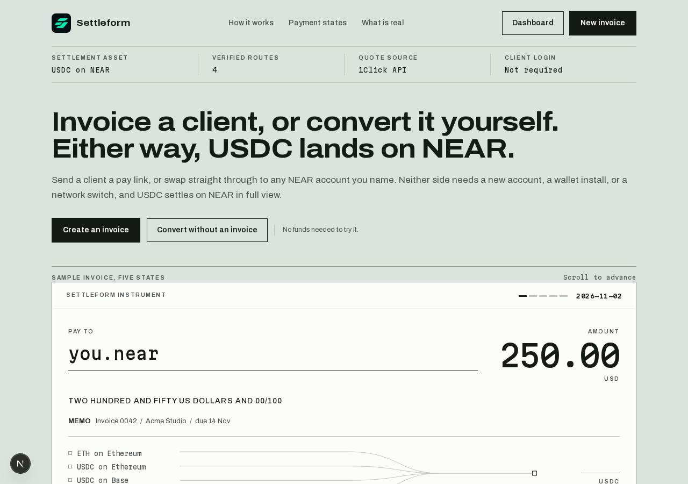
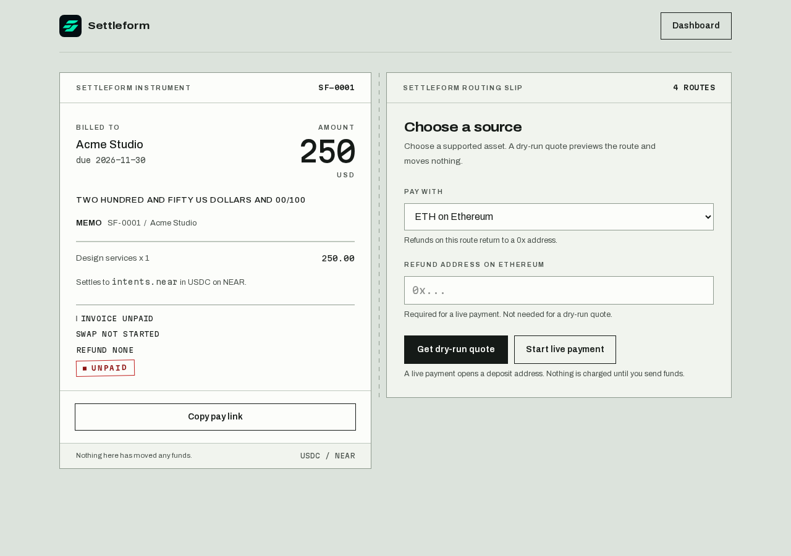
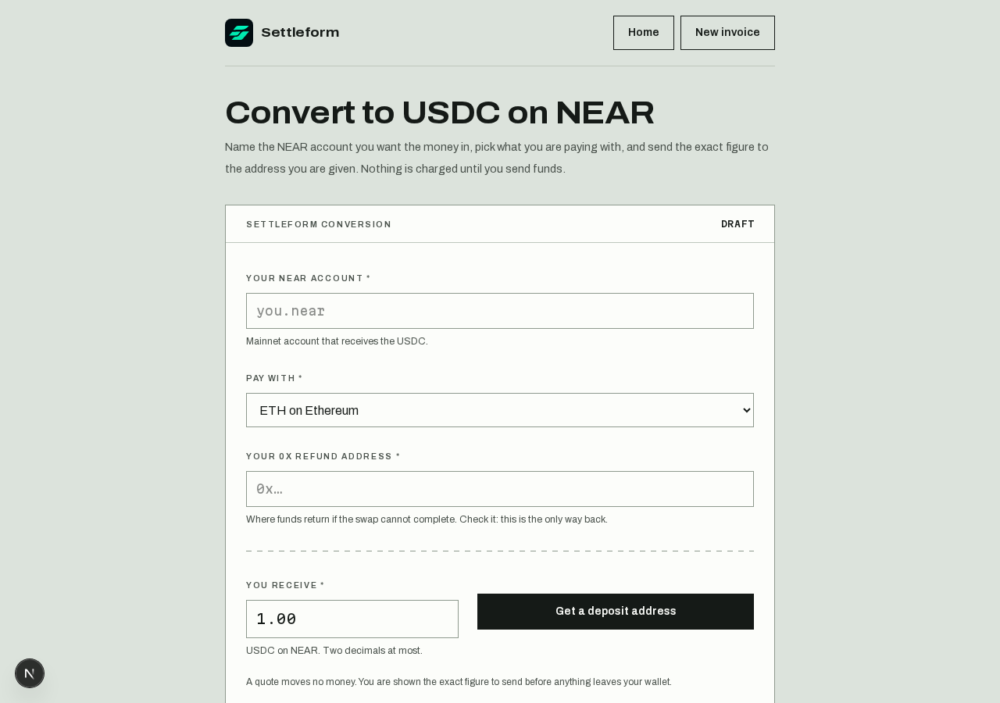

<div align="center">


# Settleform

**Cross-chain invoicing settled in USDC on NEAR.**

Invoice a client, or convert it yourself. Either way, USDC lands on NEAR.

Live demo: https://settleform.vercel.app

[](https://nextjs.org/)
[](https://react.dev/)
[](https://tailwindcss.com/)
[](./LICENSE)
[](#tests)

Built for the NEAR Hackathon (Nov 1-14, 2026). Tracks: `realworld`, `business`, `security`.

</div>

## How it works

1. **Invoice a client** - create an invoice with client, amount, due date, and
   line items. Share the public pay link. No client login.
2. **The client pays** - they pick a supported token on a supported chain, see
   a dry-run quote first, then send to a 1Click deposit address. The quote
   spells out the exact figure to send.
3. **USDC lands on NEAR** - status polls to SUCCESS, REFUNDED, or FAILED.
   A paid invoice renders as a receipt with settlement amount, transaction
   links, and CSV export. A refunded swap never reads PAID.
4. **Or convert without an invoice** - [`/convert`](#converter) swaps any
   supported token straight into any mainnet NEAR account. No conversion fee:
   what is sent is what lands.

```
Client token (ETH · Base · NEAR)  →  1Click / NEAR Intents  →  USDC on NEAR
```

## Converter

Name any mainnet NEAR account, pick a source token and a USDC amount. The
quote returns the exact source figure plus a deposit address; the status line
polls until the swap settles. Finished swaps file into a shared, paged history
with explorer links, CSV, and a receipt PNG. A still-running swap is refused
from history - it belongs to the live view, not the record.

## Fees

No conversion fee is taken by this app: the quoted USDC figure arrives in
full. The 1Click router reports its own `withdrawFee`/`refundFee` per quote,
shown on the quote panel and stored on the record. Without a 1Click JWT, an
extra unauthenticated fee (currently 0.2%) applies upstream - set
`ONECLICK_JWT` in `.env.local` to use the authenticated schedule.

## Screenshots

> Captured from the running app. The landing instrument, the pay page, and the
> converter are the product; these exist so a reader can see them without
> running it.

| Landing | Pay link | Converter |
| --- | --- | --- |
|  |  |  |

## Quickstart

Requirements: Node 20+, npm.

```bash
npm install
cp .env.example .env.local   # optional, only if you have a 1Click JWT
npm run dev
```

Open http://localhost:3000.

| Variable | Required | What it does |
| --- | --- | --- |
| `ONECLICK_JWT` | No | Authenticated 1Click schedule. Without it, an extra ~0.2% upstream fee applies. Keys stay server-side. |
| `NEXT_PUBLIC_SITE_URL` | On deploy | The public origin for metadata, canonical URLs, robots, and sitemap. Falls back to `http://localhost:3000`. |
| `TRUST_PROXY` | Behind a proxy | Set to `1` only when a proxy sets `x-forwarded-for`, so the rate limiter keys per caller. |

`data/invoices.json` and `data/conversions.json` are git-ignored local stores.
Seed them for a demo: `cp data/invoices.example.json data/invoices.json`.

## Project layout

- `app/page.tsx` - landing with settlement preview
- `app/invoices/` - dashboard plus invoice creation form
- `app/pay/[id]/` - public pay link plus receipt
- `app/convert/` - the converter: name a NEAR account, pick a token, watch the swap land
- `app/api/` - invoices, quotes, status, export, conversions
- `components/` - the brand mark, the landing instrument, the one-shot stamp
- `lib/oneclick.ts` - the 1Click layer: asset table, refund-address formats, quote and status reads
- `lib/` - invoices store, amounts (decimal strings, never floats), CSV, guards
- `test/` - store, amount, CSV, origin-guard, near-account, payment-window, oneclick tests
- `data/supported-assets.json` - the only asset source the UI reads
- `docs/` - [spec](docs/spec-settleform.md), [development guide](docs/DEVELOPMENT.md)

## Tests

```bash
npm test        # 47 tests, Node's built-in runner, no network
npm run typecheck
npm run lint
npm run build
```

## What it does not do

Honest scope, from the spec:

- No full accounting platform. Invoicing, payment tracking, settlement records, and CSV only.
- No universal chain support. Only routes verified against the 1Click API appear.
- No paid-invoice editing. A paid invoice is immutable except for refund records.
- Local JSON file store is a demo limitation, not production persistence.
- One live conversion has settled end to end (0.5 USDC, 2026-11-04). No invoice
  has reached PAID from a real deposit yet - no pay link has been funded.

## Contributing

Short version: `npm test`, `typecheck`, `lint`, and `build` must all pass.
Money copy stays honest - label simulations, never invent figures. Details in
[CONTRIBUTING.md](./CONTRIBUTING.md). Security reports go to
sketchifydev@gmail.com per [SECURITY.md](./SECURITY.md).

## License

[MIT](./LICENSE). Starter template from `create-next-app` predates the
hackathon window; the Settleform product was built in it.
